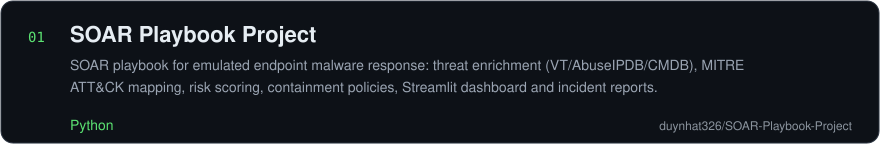
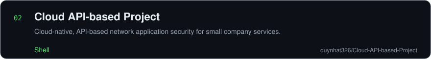
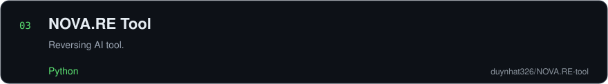
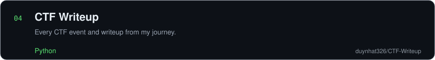
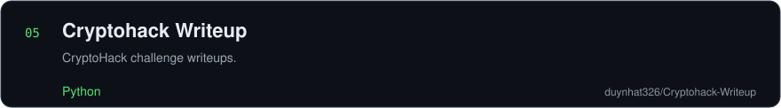
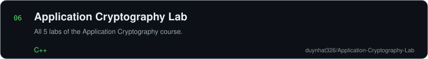
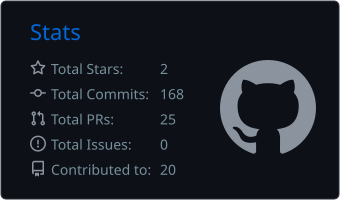
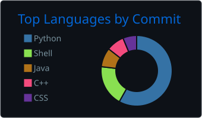

<h1 align="center">
  <code>root@duynhat326:~$</code> whoami
</h1>

<p align="center">
  <a href="https://github.com/duynhat326">
    
  </a>
</p>

<p align="center">
  
  <a href="https://github.com/duynhat326?tab=followers"></a>
</p>

---

### `$ cat about.txt`

```text
[+] name   : Nguyễn Hữu Duy Nhất
[+] role   : Information Security Student | SOC Analyst Intern | CTF Player
[+] school : HCMUTE (Ho Chi Minh City University of Technology and Engineering)
[+] focus  : SOC operations, logging research, CVE simulations
[+] ctf    : sol3_f1t @ Ph0_V@nG_nH0_Hon3y (Forensics, RE, Crypto, OSINT)
[+] tools  : Wazuh, FTK Imager, Wireshark, Cisco, nmap
[+] status : online
```

### `$ cat experience.log`

```text
[*] Intern SOC Analyst
[*] Teaching Assistant, Corporate Training Solutions Vietnam
[*] IT Supervisor Assistant, Corporate Training Solutions Vietnam
[*] ICPC (International Collegiate Programming Contest): team HCMUTE.WayToChampion
[*] RMIT Hackathon: built AI applications
[*] daily: Python scripts for crypto attacks, debugging C++ access modifiers, Leetcode
```

### `$ ls ~/stack`

<p>
  
</p>

### `$ ls ~/projects`

<p align="center">
  <a href="https://github.com/duynhat326/SOAR-Playbook-Project"></a>
</p>

<p align="center">
  <a href="https://github.com/duynhat326/Cloud-API-based-Project"></a>
</p>

<p align="center">
  <a href="https://github.com/duynhat326/NOVA.RE-tool"></a>
</p>

<p align="center">
  <a href="https://github.com/duynhat326/CTF-Writeup"></a>
</p>

<p align="center">
  <a href="https://github.com/duynhat326/Cryptohack-Writeup"></a>
</p>

<p align="center">
  <a href="https://github.com/duynhat326/Application-Cryptography-Lab"></a>
</p>

### `$ git stats --me`

<p align="center">
  
  
</p>

<p align="center">
  
</p>

### `$ ./snake.sh`

<p align="center">
  
</p>

### `$ ./contact.sh`

<p>
  <a href="https://github.com/duynhat326"></a>
  <a href="mailto:duynhatnguyen03@gmail.com"></a>
  <a href="https://www.linkedin.com/in/solenguyen/"></a>
  <a href="https://duynhat.me"></a>
</p>


